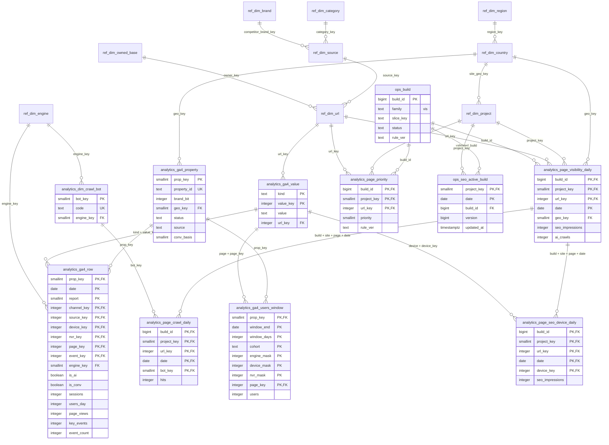

# HUB GA4·SEO 분리 ERD

원본: 워크스페이스의 `GEO HUB 골드 ERD.html` 및 `docs/reports/부록/골드 ERD 생성기/src/tables/07_ga4.js`, `08_vis.js`.
아래는 `hmg_analytics` 안의 관계입니다. 외부 Gold DB로 향하는 FK나 조회 연결은 없습니다.

도식에서는 가독성을 위해 generated `*_kind` 보조 열과 `ops.data_version`, `ops.schema_migration`은 생략했습니다.
전체 컬럼·제약·인덱스·권한의 정본은 [schema.sql](schema.sql)입니다.
