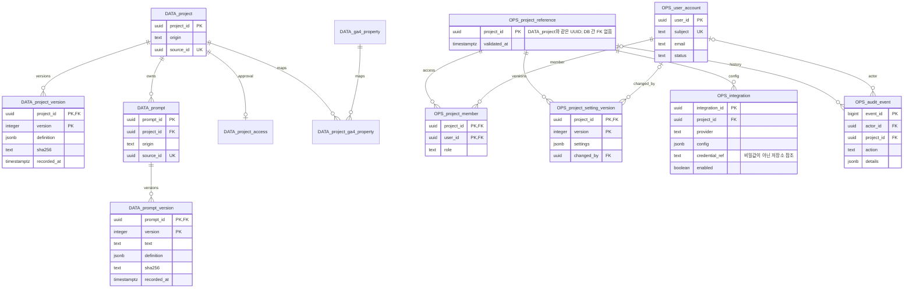

# HUB DB 분리 ERD

실선 관계는 같은 DB의 FK이다. 두 DB 사이는 서비스/가져오기 명령이 UUID 존재를 검증하며 PostgreSQL FK가 아니다.

`DATA_*`는 `hmg_analytics`의 `catalog`, `publication`, `analytics` 객체다. `OPS_*`는 `hmg_operations.system` 객체다.
GA4·SEO 상세 ERD는 [기존 ERD](../analytics/ERD.md)를 유지한다. 외부 SELECT는 `published.*` 뷰에만 허용한다.
